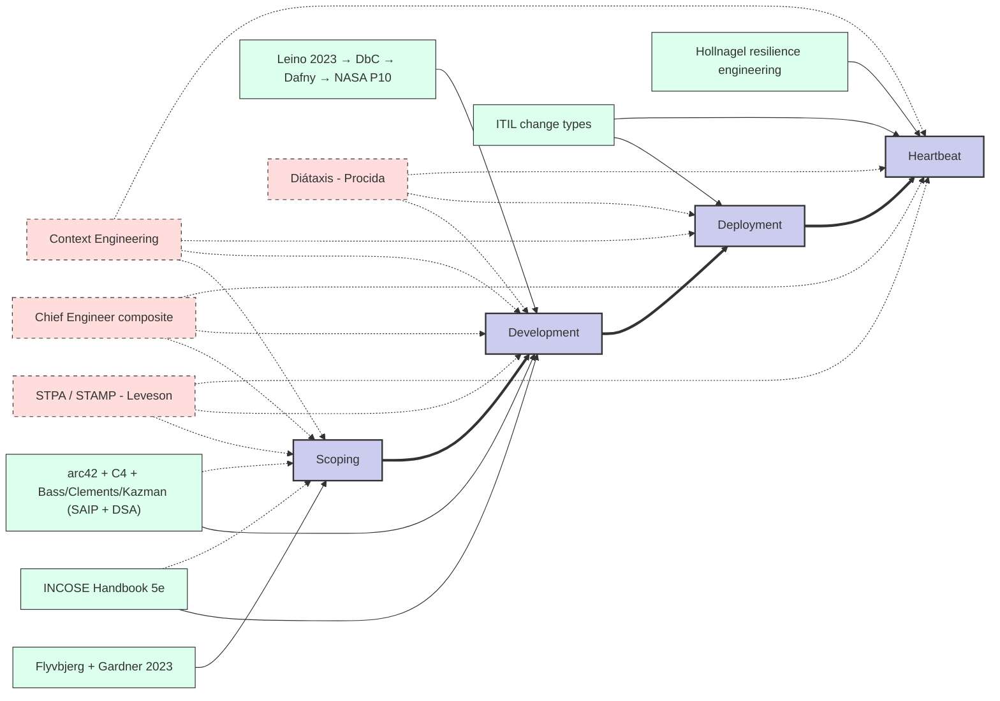

# Methodology Anchor Map (draft)

**Diátaxis mode.** Reference (anchor slate diagram, composition rules, summary table).

Anchor rationale is summarized in the slate, composition rules, and summary table below.

## Anchor-literacy assumption

The operator is assumed to be familiar with the named anchor literature at the level of its standard introductory text; the methodology does not in-line summaries. Where the methodology applies an anchor concretely, the citation in the relevant section is the load-bearing surface.

**Why this assumption holds.** ieops's primary consumer is Claude Code (per `phase-1-commitments.md` §6), which is pretrained on the methodology's named texts (Flyvbjerg, INCOSE, arc42, SAIP, DSA, C4, Leino, ITIL, Hollnagel, STPA, Diátaxis, Brooks, Johnson, the SLR-anchored Context Engineering composite). The methodology relies on that pretraining rather than reproducing it inline; this also makes the system able to explain its own design choices when asked, by citing the source where the load-bearing claim originates. Adding a new anchor not in this slate is a Charter §6 escalation, partly so that anchor literacy remains within the operator's pretrained surface or is explicitly noted when it isn't.

Solid bold arrows = lifecycle progression (time). Solid thin arrows = primary stage where an anchor governs. Dashed arrows = secondary stage where the same anchor also applies, or where a cross-cutting anchor spans multiple stages.

## Legend

- **Stages (spine):** Scoping → Development → Deployment → Heartbeat
- **Stage-specific anchors** (thin arrows): govern one stage
- **Cross-cutting anchors** (dashed): span multiple stages

## Composition rules

- Stage anchors compose within a stage (e.g., Development runs INCOSE vocabulary + arc42 structure + Leino verification stack concurrently)
- Override anchors replace defaults where specified (e.g., STPA overrides INCOSE's FMEA/FTA default for hazard analysis)
- Cross-cutting anchors impose continuous discipline (STPA hazard-control-structure informs scoping decisions, development artifacts, and runtime monitoring)
- Architecture Design cluster placement: SAIP quality attribute scenarios surface at Scoping (feed arc42 §10); ATAM is an optional Development-exit architecture-review step that activates when scope justifies (e.g., megaproject-scale work per Flyvbjerg sizing); SAIP architectural tactics are Development-stage vocabulary
- Project-Leadership cross-cut: Chief Engineer composite (Brooks *conceptual integrity* + Johnson Skunk Works 14 rules + aerospace project CE role tradition) anchors the Project Lead function at Scoping (vision setting), Development (conceptual integrity maintenance), and Heartbeat (vision-drift check). Operating template for the Acting PL persona specified separately
- Context Engineering cross-cut: composite grounded in three SLRs (attention-degradation; proportional-response / cognitive-load; role-persona-prompting) plus the HCI cognitive-ergonomics tradition (Sweller, Suchman, Hollnagel). Applies at all stages and across both artifact-level and interaction-level concerns — context budgets, spatial layout, task-aware compression, deterministic completeness, proportional context provisioning, persona-safety, terminology discipline. Operating template at `context-engineering-operating-template.md`.
- **Discoverability clause.** Every artifact in this workspace that names an anchor or a commitment must point to where that anchor or commitment is defined. Anchors → `anchor-map.md` (slate + composition rules). Commitments → `phase-1-commitments.md` §3. Pointers are by file path, not by inference. Adding a new anchor name without a corresponding entry in the project's decision log is a Charter §6 escalation (introduction of a new anchor not specified in the envelope).

## Anchor summary

| Anchor | Role | Stage(s) |
|---|---|---|
| Flyvbjerg & Gardner, *How Big Things Get Done* (2023) | Reference-class forecasting, modularity-over-monolith | Scoping |
| INCOSE SE Handbook 5e (2023) | Lifecycle vocabulary, process reference | Development (primary); Scoping (Business/Mission Analysis, Stakeholder Needs) |
| arc42 + C4 + Bass/Clements/Kazman (*Software Architecture in Practice* + *Documenting Software Architectures*) | Architecture design: operational template (arc42) + diagramming (C4) + foundational pedagogy (SAIP: quality attributes, tactics, ATAM) + documentation method (DSA: views-and-beyond) | Development (primary); Scoping (arc42 §1–3,10; SAIP quality attribute scenarios) |
| Leino, *Program Proofs* (2023) → DbC (Meyer) → Dafny → NASA P10 | Specification foundation, verification discipline, instrument, rules | Development |
| ITIL change types (standard/normal/emergency) | Change classification | Deployment, Heartbeat |
| Hollnagel, resilience engineering | Work-as-done, runtime monitoring | Heartbeat |
| STPA / STAMP (Leveson) | Hazard control structure | Scoping, Development, Heartbeat |
| Diátaxis (Procida) | Documentation architecture (four modes) | Development, Deployment, Heartbeat |
| Chief Engineer composite (Brooks *conceptual integrity* + Johnson Skunk Works 14 rules + aerospace project CE role tradition) | Project leadership: vision-holding, taste, long-term direction; Acting PL persona grounding | Scoping, Development, Heartbeat (cross-cutting) |
| Context Engineering composite (three SLRs: attention-degradation + proportional-response + persona-prompting; HCI cognitive-ergonomics tradition: Sweller / Suchman / Hollnagel) | Context ergonomics for model and human; operational context budgets, spatial layout, compression, proportional provisioning, terminology discipline, persona-safety | All stages (cross-cutting) |
